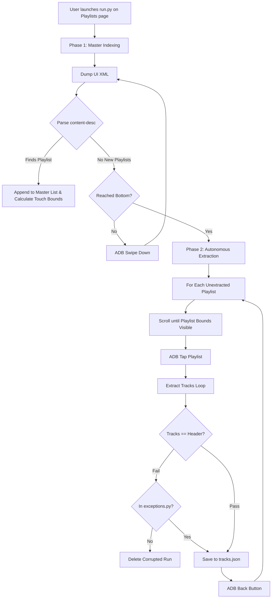
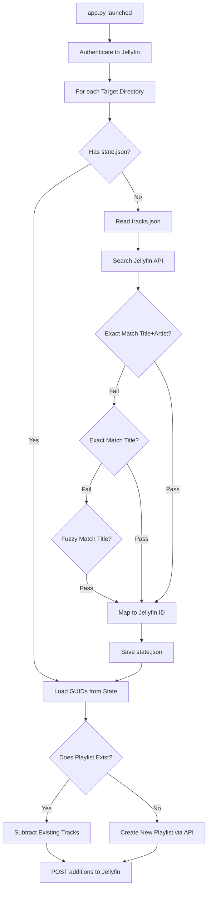

# Developer Documentation

This document serves as the comprehensive technical reference for the Finamp Playlist Resurrector. If you need to modify, debug, or extend the tools in the future, all necessary implementation details are outlined here.

## 🏗️ Architecture Overview

The system operates across two isolated processes. The first process operates strictly locally, communicating with the Android device via ADB to extract UI data. The second process operates over the network, mapping local data to the Jellyfin API.

- **`run.py`**: The extraction script. Operates via ADB to simulate human interaction and parse Android `uiautomator` XML dumps into structured JSON.
- **`exceptions.py`**: A configuration file used by `run.py` to bypass track-count sanity checks for specific playlists (useful for playlists containing intentional duplicate songs).
- **`app.py`**: The synchronization script. Authenticates with the Jellyfin API, fuzzy-matches extracted tracks, and chunks playlist creations to the server.

---

## 📱 Extraction Details (`run.py`)

`run.py` is a fully autonomous web-scraper-style tool, but applied to an Android screen. Because Finamp encrypts/obfuscates its local database, we use accessibility XML dumps to read the UI directly.

### ADB Commands Used
- `adb shell uiautomator dump /sdcard/ui_dump.xml`: Captures the current Android view hierarchy.
- `adb pull /sdcard/ui_dump.xml`: Downloads the dump to the host machine for parsing.
- `adb shell input swipe 500 2000 500 1200 500`: Performs a precise 800px vertical scroll to navigate lists without skipping items.
- `adb shell input tap <x> <y>`: Simulates a physical touch to open a specific playlist.
- `adb shell input keyevent 4`: Simulates pressing the Android "Back" button to return to the master list.

### Extraction Workflow



### Parsing Heuristics
- **Playlist List Parsing**: We search the XML nodes for `content-desc` matching `^(.+?)\n.*?\n(\d+)\s+Track(s)?(\nFavorite)?$`. From this, we extract the name, track count, and calculate the `(x, y)` center from the `bounds="[x1,y1][x2,y2]"` attribute.
- **Track Parsing**: We look for nodes where `content-desc` contains a newline and the word `Seconds`. Line 1 is the Title, Line 2 is the Artist.

### Idempotency & Fault Tolerance
If a run crashes or is interrupted, `run.py` will not corrupt data. It extracts into a `<playlist_name>_temp_run` folder first. Only if the extraction fully completes and passes the track-count Sanity Check does it replace the main directory. During Phase 1, any playlist with a complete `tracks.json` is automatically skipped.

---

## 🌐 Synchronization Details (`app.py`)

`app.py` is responsible for converting the human-readable `tracks.json` into Jellyfin Database GUIDs and appending them to remote playlists.

### Synchronization Workflow



### State Caching Mechanism (`_state.json`)
To prevent bombarding the Jellyfin API with the exact same track searches on every single run, `app.py` caches the mapped Jellyfin GUIDs. Once a playlist's tracks are successfully searched and matched, a `<playlist_name>_state.json` file is generated inside the playlist's local dump folder (e.g. `playlists/Spring_2025/state.json` or similarly safely escaped filename). This file contains a raw JSON array of Jellyfin GUID strings (e.g. `["uuid-1", "uuid-2"]`). On subsequent runs, if this file exists, the script instantly loads the GUIDs, completely bypassing the expensive API search heuristic.

### Search Matching Algorithm
Jellyfin's API search can be finicky. To ensure the highest match rate, `app.py` uses a cascading fallback heuristic:
1. **Strict Context Match**: Queries the track Title. Filters the returned results looking for a 100% exact match of the Title AND the Artist.
2. **Strict Title Match**: If the artist differs (e.g. different featured artists), it falls back to matching the exact Title only.
3. **Fuzzy Title Match**: If punctuation or parenthesis break the match (e.g. "Song (Acoustic)"), it aggressively strips the string to alphanumeric characters before the first parenthesis, searches again, and blindly accepts the top result.

### Chunking to bypass 414 URI Too Long
Jellyfin handles playlist additions via query parameters: `POST /Playlists/<id>/Items?userId=<uid>&ids=id1,id2,id3...`. 
Because each GUID is 32 characters, large playlists (500+ tracks) result in URLs exceeding 18,000 bytes. This causes Apache, NGINX, and Jellyfin's internal web server to throw a `414 URI Too Long` error. `app.py` mitigates this by slicing the payload into chunks of exactly 100 tracks, executing consecutive append operations.

---

## 💻 CLI Usage Options

### 1. `run.py`
The extraction script requires no arguments. It operates purely interactively via the terminal.
```bash
python run.py
```
**Prerequisites:** 
- The host machine must have `adb` installed.
- An Android device must be connected with USB Debugging enabled.
- The Finamp application must be open to the "Playlists" view.

### 2. `app.py`
The synchronization script can be executed in two modes:

**Batch Mode (Recommended)**: Automatically scans the local `playlists/` directory and processes every folder it finds.
```bash
python app.py --all
```

**Targeted Mode**: Synchronize a single, specific playlist folder. Useful for debugging a specific sync failure.
```bash
python app.py "Name Override" /path/to/specific/playlist_dump/
# OR 
python app.py /path/to/specific/playlist_dump/
```
